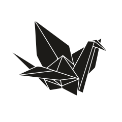

<div align="center">
  

# FOLD

**A quiet place to keep your life.**

Write it, say it, snap it. Fold keeps every memory on your phone, and only yours.

</div>

---

## Why Fold

Most of what we live never gets written down. The good dinner, the song that was playing, the thing your friend said on the walk home. Weeks later it's gone, or it's buried somewhere between screenshots and work chats.

Journaling apps tend to ask for too much: a blank page, a prompt, a daily ritual, an account, a subscription. So you stop.

Fold asks for one second. Tap, hold or swipe a single orange key, and the moment is kept. No sign-up and no cloud. Nobody else reads it.

Over time those seconds add up. Fold folds them back to you as a timeline you'll want to scroll, a calendar full of photos, and stories you didn't know you were writing.

---

## One key. Three ways to catch a moment.

| | |
|---|---|
| **Tap** to write | A clean page opens straight away. Pick a typeface and an ink colour, and Fold balances the text so it always looks considered. |
| **Hold** to record | Hold the key, talk, let go. Your voice note is saved as a memory before you've put the phone down. |
| **Swipe up** to snap | Slide the key up and the camera opens. Take the shot and it becomes a memory. |

Every memory can carry more than words: photos, videos, GIFs, a song, the place you were. Fold arranges them on the card for you, and you can drag and pinch anything to make it your own.

---

## Looking back is the best part

**The timeline.** Your memories, newest first, split by year or month or one endless scroll, whichever you prefer. As you scroll, the background picks up the colour of the photo in front of you, so every memory feels like its own room. You can turn the glow up or down in Settings.

**The Time Machine.** A calendar where each day shows a photo from that day. Tap any date to step back into it.

**From Your Past.** A slow waterfall of moments you'd forgotten, drawn at random from your whole history. Shuffle it and something else floats up.

**Stories.** Gather memories into chapters, like a trip, a year at school or a relationship, and play them back like a story. Open a memory, tap the book, and it's filed.

**Activity and Continuum.** A quiet heatmap of the days you wrote, and a streak that counts the days you've kept going. They're gentle nudges, not a guilt trip.

---

## Share the card, not the diary

Hold any memory to print it as a clean, square card stamped with the Fold mark, ready for WhatsApp, Instagram, X or anywhere else. You decide what leaves your phone, one card at a time.

---

## Private by design

Fold was built on a simple promise: **your memories never leave your device.**

- **No account.** Open the app and start. No email, no password, no profile on a server.
- **Stored on your phone.** Your words, photos, voice notes and videos stay in the app's storage on your device. We have no copy and no way to read them.
- **Lock it.** Put the whole journal behind Face ID or your fingerprint. Turn on the privacy screen to hide it in the app switcher and block screenshots.
- **Mistakes forgiven.** Deleted memories wait in Recently Deleted for 30 days before they're gone for good.
- **No ads.** Not now, not later.

To be clear about what does go online:

- **Anonymous usage stats.** We count things like app opens, which screens are used and crashes, so we can fix bugs and see what's working. It never includes what you write, record or capture. The details are in the in-app Privacy page.
- **Searches you start.** Looking up a song uses Apple's music catalogue, and looking up a GIF uses a GIF library. Only the search words are sent, never your journal.
- **Place names.** If you turn on location tagging, your phone's location service turns your position into a place name.
- **Feedback.** Anything you type into the feedback form is sent to us, because you chose to send it.

---

## Made to feel good in the hand

Fold borrows from industrial hardware and old terminals. It's honest and tactile, and a little bit analogue.

- Dot-matrix numerals, monospace type and a soft film grain on every screen.
- Motion that's layered rather than flat: things settle at slightly different speeds, so the app feels alive.
- Haptics on every press, tick and toggle, tuned separately for iPhone and Android.
- Light and dark themes that follow your phone, or pick one yourself.
- A short, hands-on Field Guide that teaches every gesture by letting you do it.

---

## Who it's for

- People who want to remember more of their life, without making a hobby of it.
- Anyone who has started a journal three times and stopped three times.
- People who care where their private thoughts are stored.
- Anyone who'd rather send a voice note to themselves than type a paragraph.

---

## In one line

**Fold: one key to keep a moment, and a beautiful way to find it again. Private, on your phone, yours.**

---

<details>
<summary><strong>For developers</strong></summary>

### Stack

Expo (SDK 57) with Expo Router, TypeScript, Zustand, expo-sqlite, React Native Reanimated 4 and Gesture Handler, expo-image, expo-video, expo-audio, expo-local-authentication. Package manager: pnpm.

### Run it

```bash
git clone https://github.com/TheAlphaOnes/fold.app.git
cd fold.app
pnpm install
pnpm expo run:ios      # or: pnpm expo run:android
```

Camera, audio recording and biometrics need a development build or a physical device. They won't work in Expo Go.

### iOS: expo-sqlite header fix

The `post_install` hook in `Podfile` renames the `sqlite3.h` include guard (`SQLITE3_H` to `EXSQLITE3_H`) and fixes the ExpoSQLite modulemap path. Without it the iOS build fails with errors like `cannot find 'exsqlite3_bind_text' in scope`. Don't remove that block. It runs again on every `pod install`.

### Layout

```
src/
├── app/          # screens (Expo Router)
├── components/   # UI building blocks
├── db/           # SQLite schema and queries
├── hooks/        # stores and hooks
├── services/     # haptics, trash, media storage, resurfacing
├── constants/    # theme, motion, guide, ASCII art
└── utils/        # small pure helpers
```

</details>

---

## License

Private. All rights reserved.
